

<picture><source media="(max-width: 767px)" srcset="variants/phone/assets/hero.svg">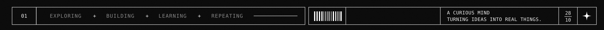</picture>
<picture><source media="(max-width: 767px)" srcset="assets/blank.svg"></picture>
<a href="https://github.com/OVERxPOWERED"><picture><source media="(max-width: 767px)" srcset="assets/blank.svg">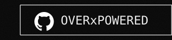</picture></a><a href="https://www.linkedin.com/in/burhanuddin-bohra-629abb370/"><picture><source media="(max-width: 767px)" srcset="assets/blank.svg">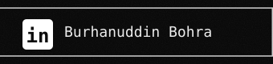</picture></a><a href="mailto:6burhanuddin6@gmail.com"><picture><source media="(max-width: 767px)" srcset="assets/blank.svg">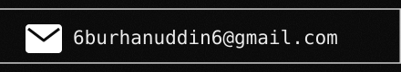</picture></a><picture><source media="(max-width: 767px)" srcset="assets/blank.svg">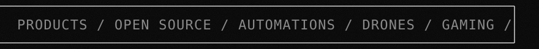</picture><a href="https://github.com/OVERxPOWERED"><picture><source media="(max-width: 767px)" srcset="variants/phone/assets/btn-github.svg"></picture></a><a href="https://www.linkedin.com/in/burhanuddin-bohra-629abb370/"><picture><source media="(max-width: 767px)" srcset="variants/phone/assets/btn-linkedin.svg"></picture></a><a href="mailto:6burhanuddin6@gmail.com"><picture><source media="(max-width: 767px)" srcset="variants/phone/assets/btn-email.svg"></picture></a>
<picture><source media="(max-width: 767px)" srcset="assets/blank.svg">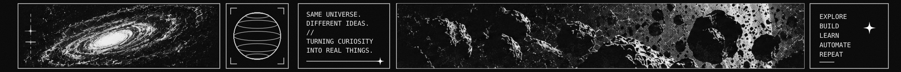</picture>
<picture><source media="(max-width: 767px)" srcset="variants/phone/assets/about.svg">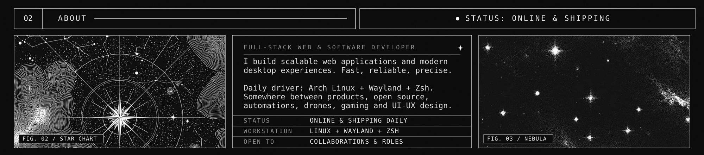</picture>
<picture><source media="(max-width: 767px)" srcset="variants/phone/assets/arsenal.svg">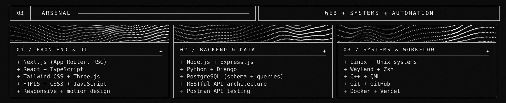</picture>
<picture><source media="(max-width: 767px)" srcset="variants/phone/assets/work-title.svg">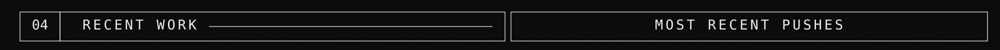</picture>
<a href="https://github.com/OVERxPOWERED/AGNITIA-TERRA06"><picture><source media="(max-width: 767px)" srcset="assets/blank.svg">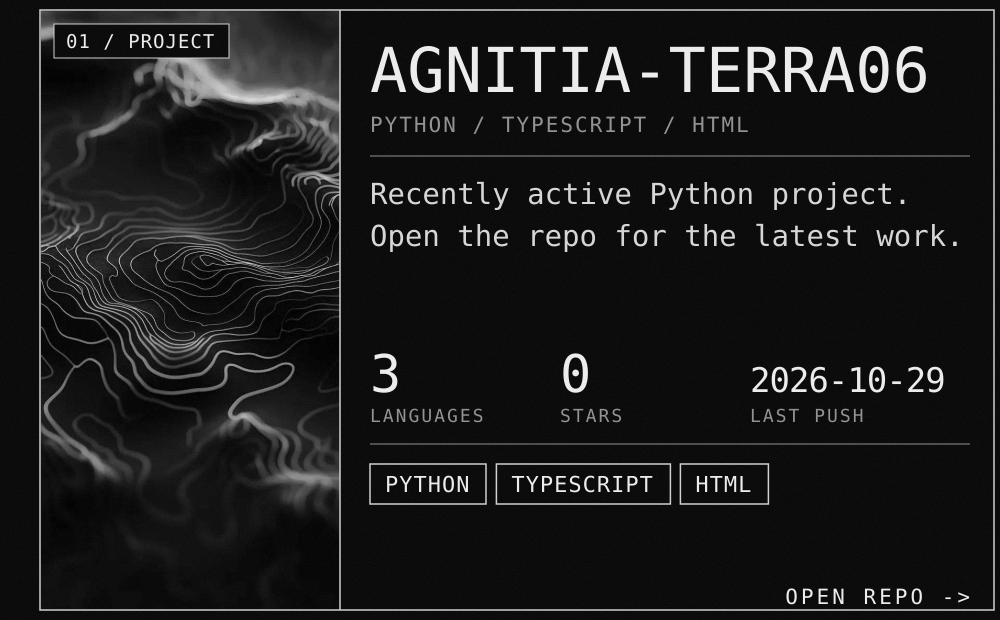</picture></a><a href="https://github.com/OVERxPOWERED/RollsRoyce-Web-clone"><picture><source media="(max-width: 767px)" srcset="assets/blank.svg">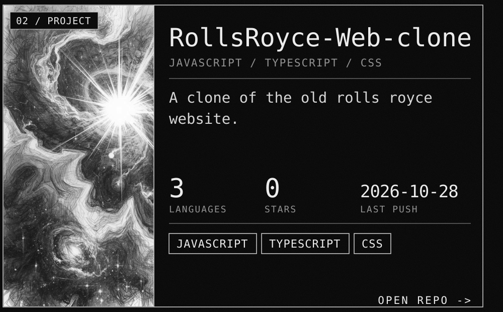</picture></a><a href="https://github.com/OVERxPOWERED/AGNITIA-TERRA06"><picture><source media="(max-width: 767px)" srcset="variants/phone/assets/work-1.svg"></picture></a><a href="https://github.com/OVERxPOWERED/RollsRoyce-Web-clone"><picture><source media="(max-width: 767px)" srcset="variants/phone/assets/work-2.svg"></picture></a>
<a href="https://github.com/OVERxPOWERED/Shortcuts"><picture><source media="(max-width: 767px)" srcset="assets/blank.svg">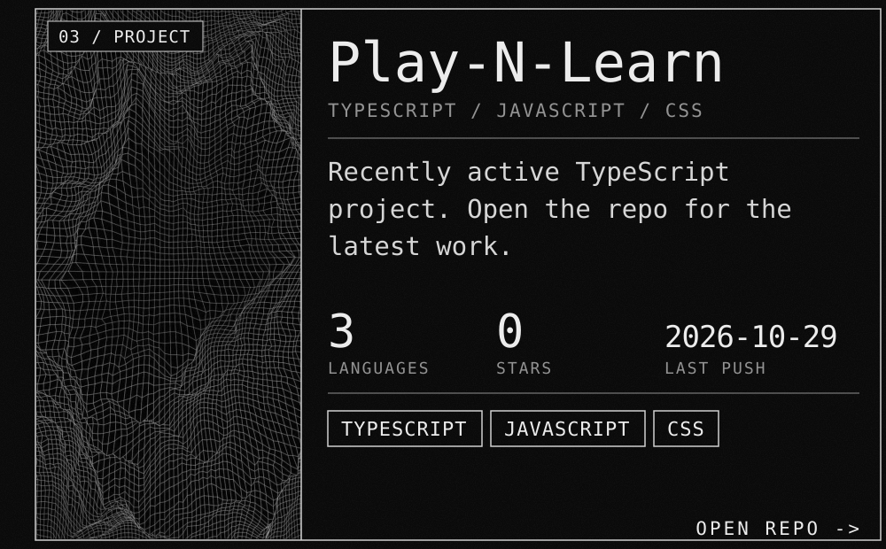</picture></a><a href="https://github.com/OVERxPOWERED/Sticky-Notes-App"><picture><source media="(max-width: 767px)" srcset="assets/blank.svg">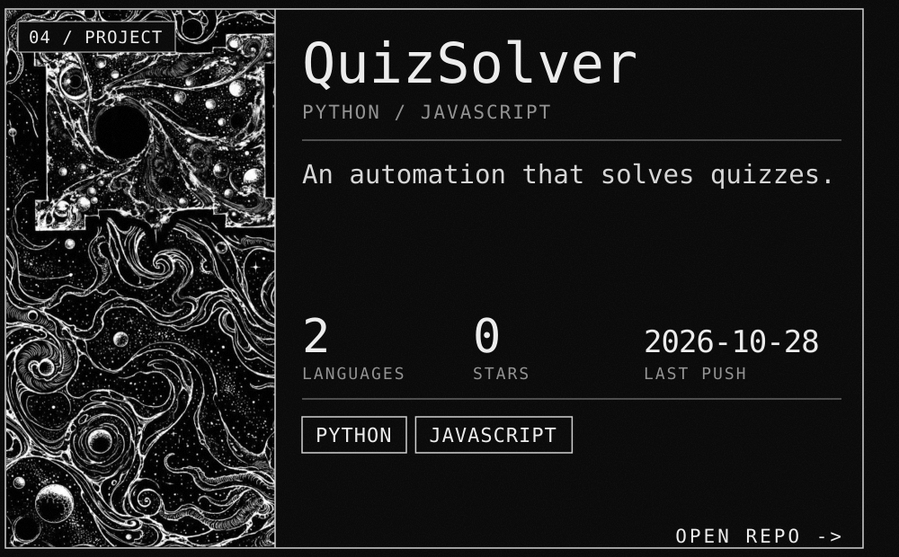</picture></a><a href="https://github.com/OVERxPOWERED/Shortcuts"><picture><source media="(max-width: 767px)" srcset="variants/phone/assets/work-3.svg"></picture></a><a href="https://github.com/OVERxPOWERED/Sticky-Notes-App"><picture><source media="(max-width: 767px)" srcset="variants/phone/assets/work-4.svg"></picture></a>
<picture><source media="(max-width: 767px)" srcset="variants/phone/assets/oss-title.svg">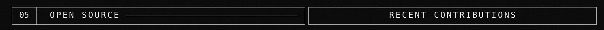</picture>
<a href="https://github.com/NetPranav/WebGen"><picture><source media="(max-width: 767px)" srcset="assets/blank.svg">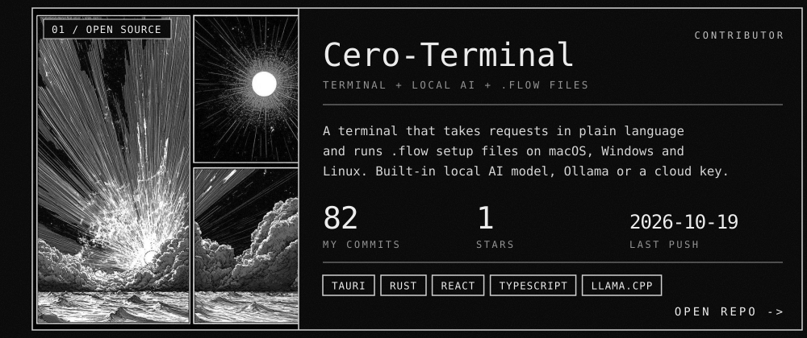</picture></a><a href="https://github.com/NetPranav/Cero-Terminal"><picture><source media="(max-width: 767px)" srcset="assets/blank.svg">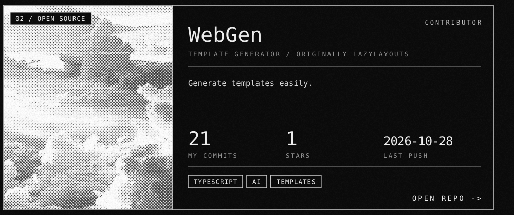</picture></a><a href="https://github.com/NetPranav/WebGen"><picture><source media="(max-width: 767px)" srcset="variants/phone/assets/oss-1.svg"></picture></a><a href="https://github.com/NetPranav/Cero-Terminal"><picture><source media="(max-width: 767px)" srcset="variants/phone/assets/oss-2.svg"></picture></a>
<a href="https://github.com/NetPranav/Marg-Backend"><picture><source media="(max-width: 767px)" srcset="assets/blank.svg">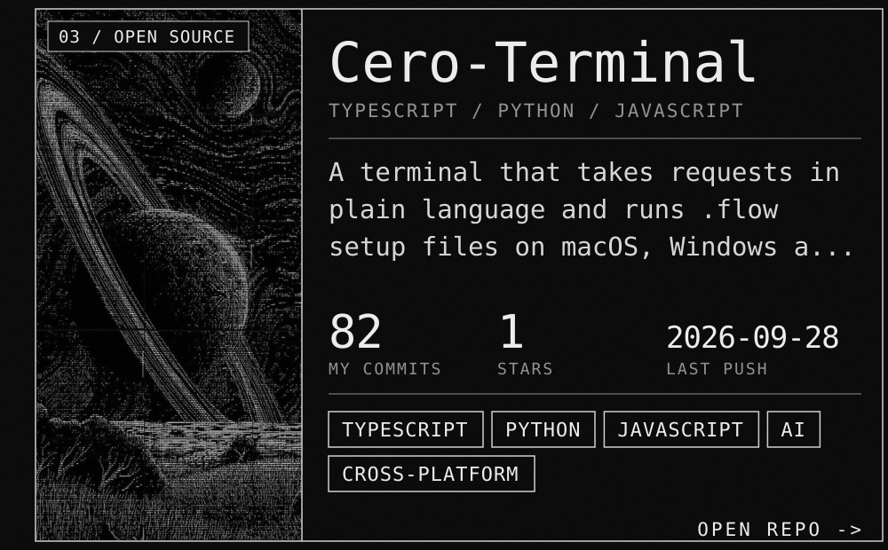</picture></a><a href="https://github.com/NetPranav/Marg-Warehous"><picture><source media="(max-width: 767px)" srcset="assets/blank.svg">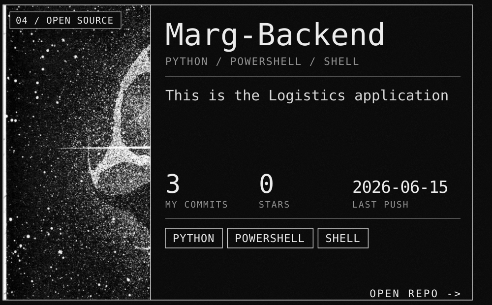</picture></a><a href="https://github.com/NetPranav/Marg-Backend"><picture><source media="(max-width: 767px)" srcset="variants/phone/assets/oss-3.svg"></picture></a><a href="https://github.com/NetPranav/Marg-Warehous"><picture><source media="(max-width: 767px)" srcset="variants/phone/assets/oss-4.svg"></picture></a>
<picture><source media="(max-width: 767px)" srcset="variants/phone/assets/stats.svg"></picture>
<picture><source media="(max-width: 767px)" srcset="variants/phone/assets/footer.svg">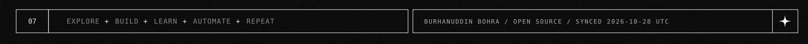</picture>

