<a href="https://github.com/OVERxPOWERED">GitHub</a> &nbsp;/&nbsp;
<a href="https://www.linkedin.com/in/burhanuddin-bohra-629abb370/">LinkedIn</a> &nbsp;/&nbsp;
<a href="mailto:6burhanuddin6@gmail.com">6burhanuddin6@gmail.com</a>

I build scalable web applications and modern desktop experiences: fast, reliable, precise.
Daily driver is Arch Linux with Wayland and Zsh. I spend my time between products, open source, automations, drones, gaming and UI/UX design.

### Selected work

- **[op-caelestia-shell](https://github.com/OVERxPOWERED/op-caelestia-shell)** &mdash; Fluid, morphing Wayland desktop shell with zero-latency interaction. 
  `QML` `C++` `GLSL` `Wayland`
- **[PocketFix](https://github.com/OVERxPOWERED/PocketFix)** &mdash; Production-ready full-stack task and workflow app. 
  `Next.js` `TypeScript` `PostgreSQL`
- **[Marg](https://github.com/OVERxPOWERED/Marg)** &mdash; Freight dispatch, real-time tracking and route management. 
  `Next.js` `TypeScript` `Python`
- **[QuizSolver](https://github.com/OVERxPOWERED/QuizSolver)** &mdash; Parses and evaluates structured assessments with automation. 
  `Python`

### Stack

`Next.js` `React` `TypeScript` `Tailwind CSS` `Three.js` &nbsp;/&nbsp; `Node.js` `Express` `Python` `Django` `PostgreSQL` &nbsp;/&nbsp; `Linux` `Wayland` `Zsh` `C++` `QML` `Git` `Docker`

EXPLORE &middot; BUILD &middot; LEARN &middot; AUTOMATE &middot; REPEAT

