

<a href="https://github.com/OVERxPOWERED">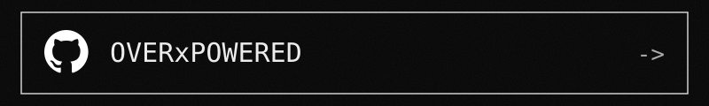</a>
<a href="https://www.linkedin.com/in/burhanuddin-bohra-629abb370/">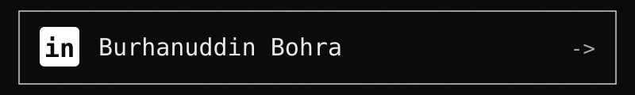</a>
<a href="mailto:6burhanuddin6@gmail.com">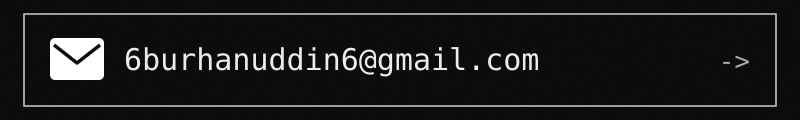</a>
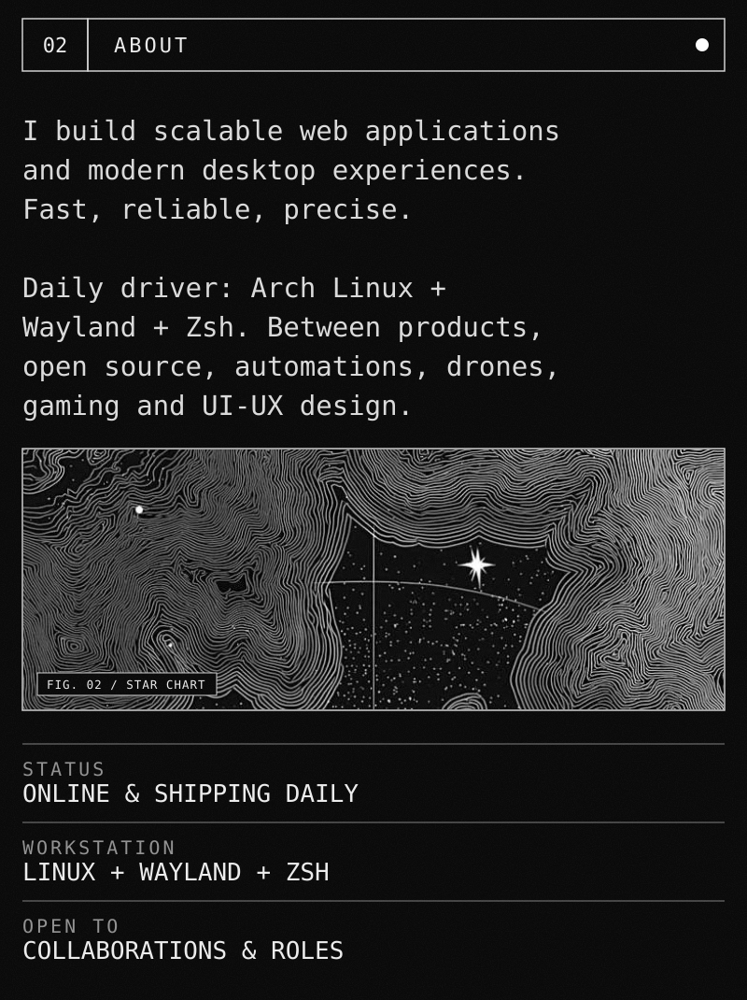
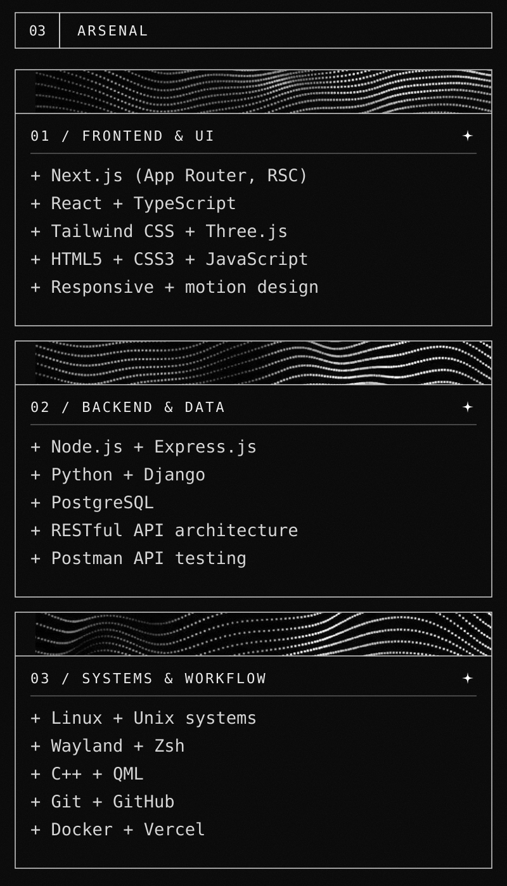
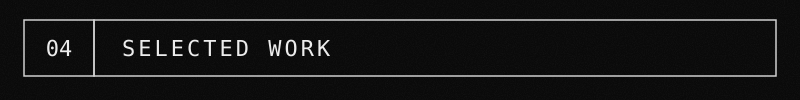
<a href="https://github.com/OVERxPOWERED/op-caelestia-shell">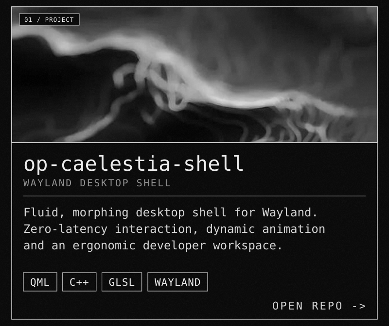</a>
<a href="https://github.com/OVERxPOWERED/PocketFix">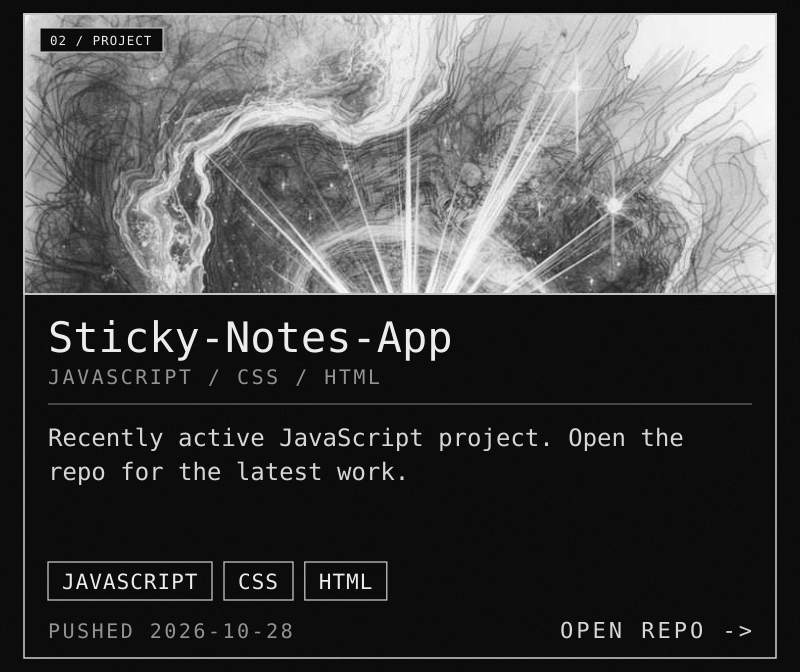</a>
<a href="https://github.com/OVERxPOWERED/Marg">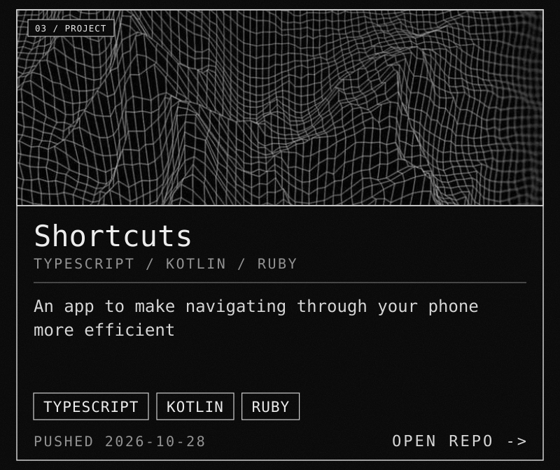</a>
<a href="https://github.com/OVERxPOWERED/QuizSolver">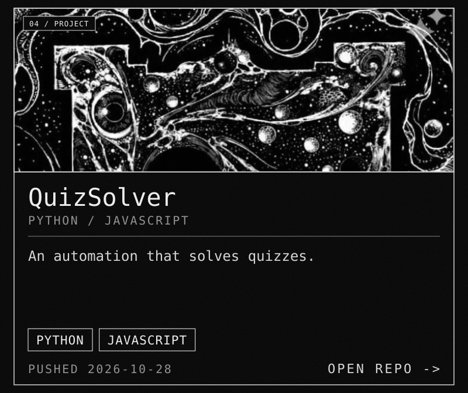</a>
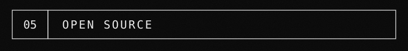
<a href="https://github.com/NetPranav/Cero-Terminal">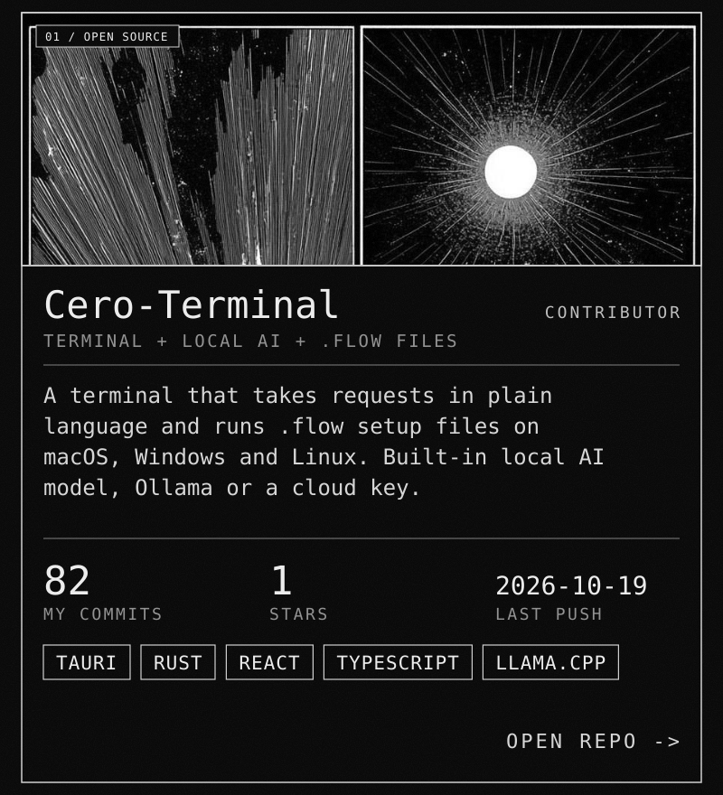</a>
<a href="https://github.com/NetPranav/WebGen">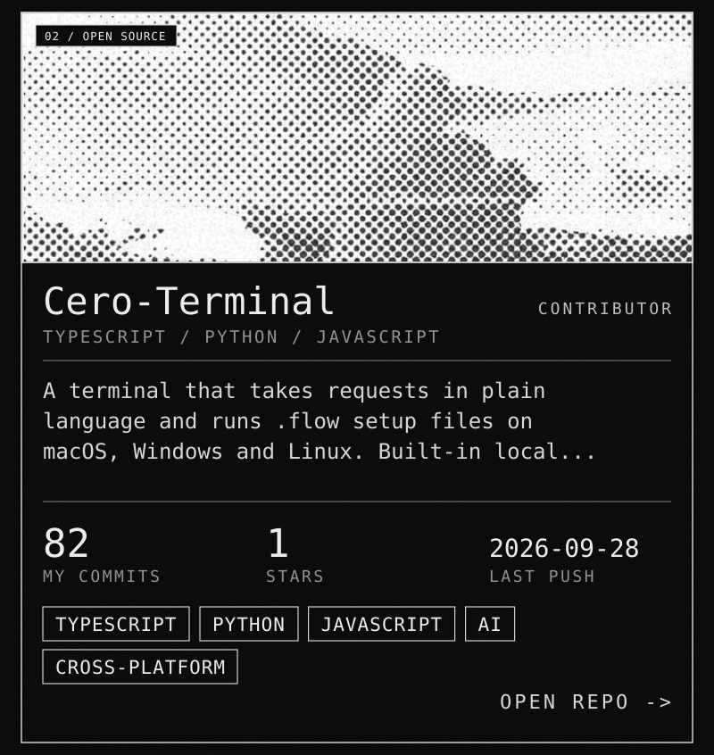</a>
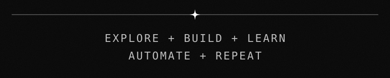

